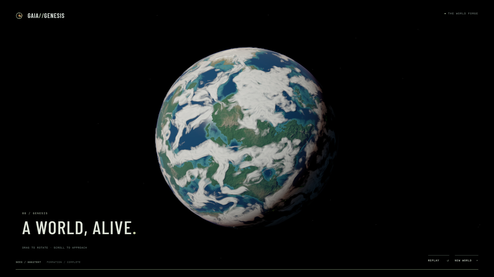

# GAIA//GENESIS

A 32-second real-time planetary birth, integrating actual MIT source from **Cosmos**, **Cosmic Collisions** and **Stardust**. Desktop WebGL2, TypeScript, Three.js and one GSAP timeline. No backend, API keys or video. Default worlds are procedural; NASA imagery exists only in a labelled developer reference mode.

[Open the live scene](https://rednebula100.github.io/gaia-genesis/) · [Anatomical frame](docs/screenshots/source-integration/26.1.jpg)

[Source integration captures](docs/screenshots/source-integration/README.md) · [Source provenance](docs/SOURCE_PROVENANCE.md) · [Verification](docs/VERIFICATION.md)



## Run

Node 22.12+:

```sh
npm install
npm run dev
```

Open `http://127.0.0.1:5173/gaia-genesis/`. Production: `npm run build`, then `npm run preview`. Windows Chrome checks: start the dev server, then `npm run verify` (uses installed Windows Chrome).

## Experience

GPU planetesimal merging → giant impact → particle reaccretion → liquid metal differentiation → basalt cooling → ocean/atmosphere → mature anatomy → closure. Skip, Replay, New World; drag/scroll in the final scene. Keyboard: focus the canvas, arrows rotate, +/- zoom. The bottom timeline supports pointer/keyboard scrubbing. `?seed=162711` reproduces the world. Loading includes worker map generation, original GPU physics prepasses and shader warming; hidden tabs pause the film.

## Scientific scope

This is art direction, not a physical formation simulation. Initial liquid metal differentiation and the much later solid inner core are **not simultaneous events**. The signature shot is labelled a mature interior/time projection. Inner core radius: **0.1916 R**; liquid outer core boundary: **0.546 R**; mantle outer boundary: **0.985 R**. Crust thickness is exaggerated to **0.015 R**. The mantle is represented as mostly solid silicate; animated plume/slab motifs compress geological time. The liquid core is opaque metal, not transparent water.

Cosmos uses simplified dimensionless N-body merging. Cosmic Collisions uses approximate particle-mesh gravity and contact/heat, not SPH, shock or phase-change physics. Stardust reassembly is animation, not gravity. These are staged models with art-directed handoffs, not one conserved formation simulation. [Exact source paths and adaptations](docs/SOURCE_PROVENANCE.md).

Plate-neighbourhood uplift, coast distance, altitude and humidity are artistic heuristics. Fine cloud fronts use the restored original full-resolution skin, with a restrained raymarched 3-D optical-depth layer beneath. Multiple-scattering fill and surface shadows are approximate; this is not fully volumetric fine weather. The 0.001–0.006 R cloud height is exaggerated. The uncut atmosphere uses Takram/Bruneton Rayleigh/Mie/ozone LUTs; it fades during detached anatomy because one spherical LUT cannot describe both pieces. Interior lighting is an exhibit key.

## Rendering and reference

One WebGL2 renderer: source engine stages → linear half-float HDR → detailed cloud skin / fixed half-resolution volume → atmospheric LUTs → restrained highlight bloom → **one AgX tone map and sRGB output**. There is **no FPS-triggered DPR or cloud-resolution reduction**. Source physics runs once per seed in a temporary GL context during loading; cached position/velocity/material/heat buffers cross contexts safely. They are states, not rendered frames. The prepass context is disposed before playback. Shaders and a collision composite are warmed under the loading veil.

`?reference=earth` opens a **developer-only NASA Blue Marble reference**, automatically at the final shot, under the same sun/camera/LUT pipeline. NASA surface/coverage maps are not used by generated worlds. It is an optical comparison, not a claim that generated geology equals observed Earth. Credits and original URLs are in [notices](THIRD_PARTY_NOTICES.md).

Adapters live under `src/engines/`; pinned MIT sources under `src/vendor/`. Existing terrain, geometry, optics and timeline remain separate modules. Seed + film time determine state. Paused inspection frames accumulate no temporal history. New World disposes replaced maps, materials, geometry, collision targets and temporary GL resources.

## Deployment

GitHub Actions builds on `main` push and publishes `dist/` to GitHub Pages. The Vite base is `/gaia-genesis/`. Enable Pages with Source: **GitHub Actions**. If using a different repository name, update `vite.config.ts` base to match it. No secrets are required.

## Scope and limitations

Desktop only, designed for 1920×1080 and 1280×720. Graphics acceleration required. No sound, exploration, editor or climate solver. Interior textures are illustrations. Collision resolution is bounded at 32,768 particles; the original's spark-streak and separate vapour-atmosphere passes are not ported. The hybrid clouds are approximate. Fidelity remains fixed on slow GPUs; measured FPS and captures are in verification. No universal NASA/photographic fidelity or frame-rate claim is made.

See [reference decisions](docs/ART_REFERENCE_NOTES.md), [notices](THIRD_PARTY_NOTICES.md) and [verification](docs/VERIFICATION.md).
