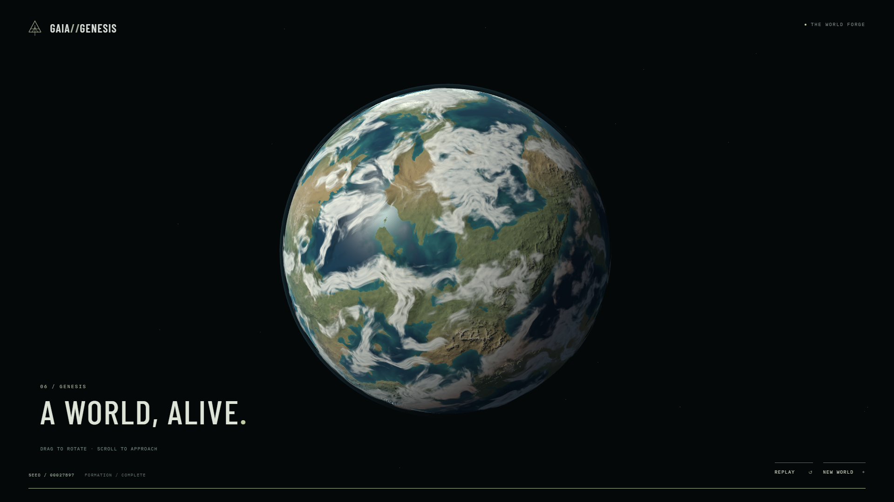

# GAIA//GENESIS

A 22-second real-time planetary birth. An independent desktop WebGL2 scene built with TypeScript, Three.js and one GSAP timeline. No backend, API keys, remote planet textures or video.

[Open the live scene](https://rednebula100.github.io/gaia-genesis/) · [Anatomical frame](docs/screenshots/anatomy-1280.png)



## Run

Node 22.12+:

```sh
npm install
npm run dev
```

Open `http://127.0.0.1:5173/gaia-genesis/`. Production: `npm run build`, then `npm run preview`. Windows Chrome checks: start the dev server, then `npm run verify` (uses installed Windows Chrome).

## Experience

Accretion → metal differentiation → continuous basalt cooling → ocean/atmosphere → mature anatomical projection → closure. Skip, Replay, New World; drag/scroll in the final scene. Keyboard: focus the canvas, arrows rotate, +/- zoom. The narrow bottom timeline can also be scrubbed with pointer or keyboard. A `?seed=162711` URL reproduces the world; New World updates it. Loading is performed in a worker, and hidden tabs pause the film.

## Scientific scope

This is art direction, not a physical formation simulation. Initial metal differentiation and the much later solid inner core are **not simultaneous events**. The early view treats central metal as hot liquid; the signature shot is explicitly labelled a mature interior/time projection. Solid inner core radius: 0.19 R; liquid outer core boundary: 0.55 R. Mantle extends to 0.975 R. Crust thickness is **exaggerated to 0.025 R** for legibility. Internal flow is a slow material illustration, not a fluid solver. Ocean and clouds are shaded geometric layers, not climate simulation. Formation is compressed into 22 seconds.

## Deployment

GitHub Actions builds on `main` push and publishes `dist/` to GitHub Pages. The Vite base is `/gaia-genesis/`. Enable Pages with Source: **GitHub Actions**. If using a different repository name, update `vite.config.ts` base to match it. No secrets are required.

## Scope and limitations

Desktop only, designed for 1920×1080 and 1280×720. WebGL2/graphics acceleration required. No mobile controls, sound, exploration, editor or climate simulation. Seeded terrain is an artistic domain-warped noise model, not tectonics. Clouds use lit shells with projected texture shadows rather than expensive volumetric integration. Resolution can step down to 1× under sustained low frame rates; hardware performance varies.

See [reference decisions](docs/ART_REFERENCE_NOTES.md), [notices](THIRD_PARTY_NOTICES.md) and [verification](docs/VERIFICATION.md).
