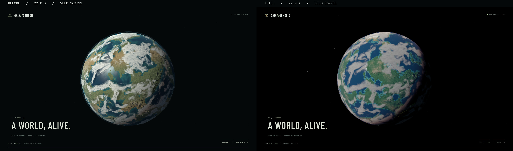
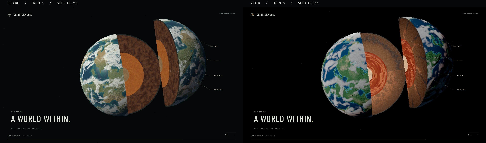

# Actual render captures

Latest: [32-second source integration captures and three-way exterior comparison](source-integration/README.md). The following images document the earlier 22-second remaster.

Windows Chrome, 1920×1080, seed 162711. Before: original `d4488fb`; after: remaster. Same timeline positions; camera choreography and seeded generation are intentionally changed. Images are direct browser captures. Comparison sheets only place the original captures beside each other and add labels.

| Film time | Before | After |
| --- | --- | --- |
| 1.8 | [Accretion](remaster/before/1.8.png) | [Accretion](remaster/after/1.8.png) |
| 5.1 | [Differentiation](remaster/before/5.1.png) | [Differentiation](remaster/after/5.1.png) |
| 9.0 | [Cooling](remaster/before/9.0.png) | [Cooling](remaster/after/9.0.png) |
| 12.5 | [Ocean / atmosphere](remaster/before/12.5.png) | [Ocean / atmosphere](remaster/after/12.5.png) |
| 16.9 | [Anatomy](remaster/before/16.9.png) | [Anatomy](remaster/after/16.9.png) |
| 22.0 | [Completed world](remaster/before/22.0.png) | [Completed world](remaster/after/22.0.png) |

