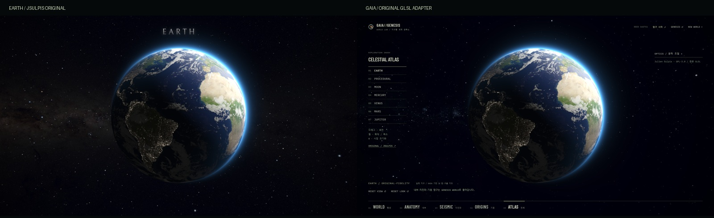
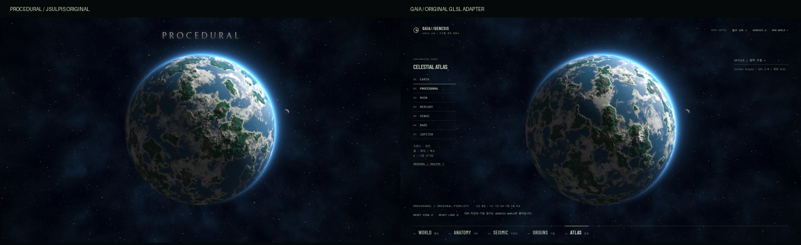

# Original GLSL → GAIA Celestial Atlas

Actual installed Windows Chrome captures, 2026-11-12, Intel UHD / ANGLE Direct3D 11. Original live site and integrated renderer: **1920×1080, DPR 1, shader time 0, default uniforms and rotation offset .6**. Original `uTime` uploads were frozen to 0 for comparison; no source image is substituted for a renderer. The original site's top heading remains in its captures. Integrated raw-render captures hide only the GAIA UI. These reviewed JPEGs derive from lossless PNG captures; layout captures include the real UI.

Left: [Julien Sulpis original live site](https://jsulpis.github.io/realtime-planet-shader/). Right: this repository's separate WebGL2 worker executing the pinned original GLSL. [Source, runtime paths, licenses and asset changes](../../ATLAS_SOURCE.md).

| Body | Comparison | Full original / integrated render |
|---|---|---|
| Earth | [side by side](compare-earth.jpg) | [original](original-earth.jpg) / [GAIA](gaia-earth.jpg) |
| Procedural | [side by side](compare-procedural.jpg) | [original](original-procedural.jpg) / [GAIA](gaia-procedural.jpg) |
| Moon | [side by side](compare-moon.jpg) | [original](original-moon.jpg) / [GAIA](gaia-moon.jpg) |
| Mercury | [side by side](compare-mercury.jpg) | [original](original-mercury.jpg) / [GAIA](gaia-mercury.jpg) |
| Venus | [side by side](compare-venus.jpg) | [original](original-venus.jpg) / [GAIA](gaia-venus.jpg) |
| Mars | [side by side](compare-mars.jpg) | [original](original-mars.jpg) / [GAIA](gaia-mars.jpg) |
| Jupiter | [side by side](compare-jupiter.jpg) | [original](original-jupiter.jpg) / [GAIA](gaia-jupiter.jpg) |

For the six texture modes, comparing the lossless captures inside a central circle (center 960,540; radius 335 px, entirely inside the planet) gave **zero RGB difference** for Earth, Moon, Mercury and Jupiter. Venus and Mars each had one 1/255 channel discrepancy among over one million compared channel values. This confirms the tested planet interior region on this GPU/time, **not** pixel identity of the whole frame, limb, every GPU or every animation frame. The new licensed star image changes the background. No image-matching adjustments were made to the shaders.

Procedural's independently generated 32³ noise changes its terrain, clouds and moon surface pattern; the same seed reproduces that new pattern. The unmodified original FBM/domain-warp palette, atmosphere, cloud detail, moon orbit and shadow retain their original visual character. It is not a copy of the original noise asset or identical continents. Its resolution stays at original optimal quality 2 (3840×2160 drawing buffer for these 1920×1080 captures); the texture modes use the original DPR-1 buffer here.

The reference captures include rendered GPL shader output and credited NASA/Solar System Scope map imagery. Original captures use the original site's background as visual comparison only; that uncredited texture itself is **not** distributed as a runtime asset. GAIA runtime background uses Solar System Scope / INOVE's official 8K Milky Way image under CC BY 4.0. See the asset manifest for credits and changes.

UI: [WORLD Reference at 1920×1080](reference-world-1920.jpg), [Atlas optics at 1280×720](atlas-optics-1280.jpg), [Jupiter at 1280×720](atlas-jupiter-1280.jpg). The inspector scrolls internally; the page does not scroll.
