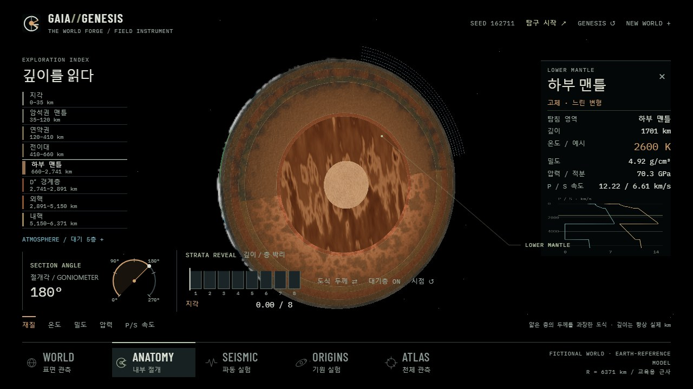
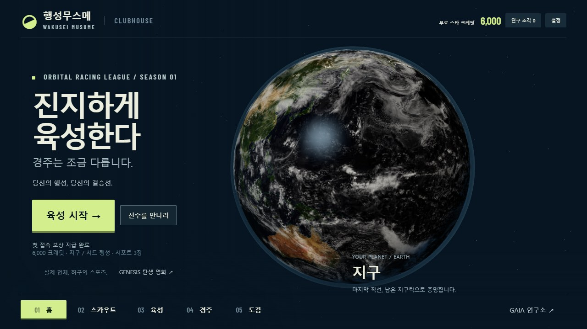
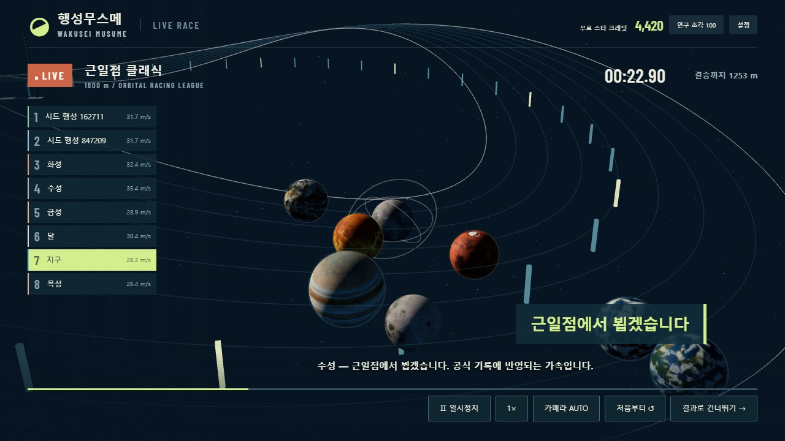
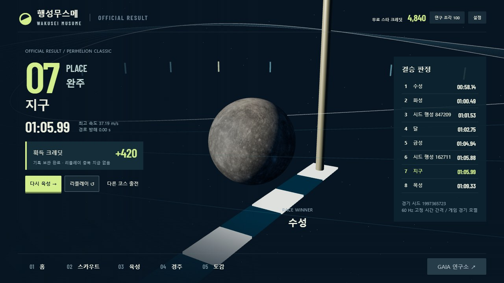

# Planet Musume — actual Chrome captures

Windows Chrome 157 / Intel UHD / ANGLE D3D11, DPR 1. These are real live 3D renders; no scene images or results were composited. Original game reference screenshots are not distributed. [End-to-end run data](verification.json) records one complete fresh-player run: both one/ten-pull pools, actual core task/reward, career reload, ten turns/events/skill, all eight finishers, pause/2×/camera/replay/skip and reward idempotency, with zero console/page errors. The model additionally checks both courses, stat/strategy effects and exact seeded event/state reproduction. Some views were re-rendered from an earlier actually played save after visual corrections; result and restored-result images therefore show different valid careers/race seeds.

## Before → after

Before is the actual previously shipped GAIA instrument, not an invented mockup. It is still available in the game, with its renderer and controls preserved. After is a new playable sports front end.

| Existing default / retained science UI | New default / playable game |
|---|---|
| [World Forge at 1280×720](../ui-remaster/after-anatomy-1280.jpg) | [Home at 1280×720](home-1280.jpg) |
| [World Lab / Anatomy](../world-lab/README.md) | [Training and immediate stat choices](training-1280.jpg) |

## Playable sequence

| Screen | Actual capture |
|---|---|
| Home, three desktop viewports | [1920×1080](home-1920.jpg), [1600×900](home-1600.jpg), [1280×720](home-1280.jpg) |
| Scout / duplicates / support | [Planet results](scout.jpg), [support results](support.jpg) |
| Team / collection | [Selection and deck](setup.jpg), [collection](collection.jpg) |
| Training | [1920×1080](training-1920.jpg), [1600×900](training-1600.jpg), [1280×720](training-1280.jpg), [choice event](event.jpg) |
| Real legacy lab special task | [Inner core selected, actual 135° cut, reward enabled](lab.jpg) |
| Entry / live broadcast | [Paddock](paddock.jpg), [race](race.jpg), [native skill](skill.jpg) |
| Actual result / persistence | [Winner and independent player rank](result.jpg), [end-to-end restored result](result-restored.jpg) |

[Moving race — actual recorded 3D, not a shipped game movie](https://rednebula100.github.io/gaia-genesis/media/race-preview.webm). The clip replays a configuration saved by the earlier real UI playthrough; it seeks the same fixed-step simulation to the middle of the race to show camera/skill motion concisely. Gameplay itself renders and simulates in real time and never plays this file. The full fresh-player recording is retained locally under ignored `artifacts/musume/full-playthrough.webm`.

## Revisions from observed problems

Initial warm-up camera divergence and canvas-selection collision were fixed. The 720p support strip no longer overlaps actions. Scout results occupy the left side so their actual 3D assembly remains visible; an opaque result panel prevents banner ghosting. Overbright Earth specular was reduced. Selected course contrast is explicit even after importing legacy styles. The misplaced horizontal starting pipes became a cross-lane stripe and upright posts. Menu camera changes snap to their established framing, while the race director retains its eased pursuit/skill moves. AUTO establishes the circuit briefly then spends most of its time closer to the real contestants. The result isolates the actual winning sphere, rather than hiding it behind co-located finishers. These are direct visual corrections, not extra modes.

The [reference audit](../../design/PLANET_MUSUME_REFERENCE_AUDIT.md) names the inspected sources and external-video playback limitations. The game intentionally uses its own fonts, colours, artwork and commentary.
