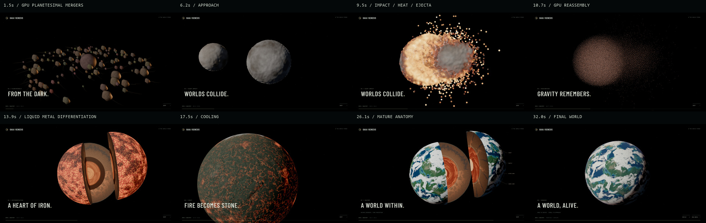
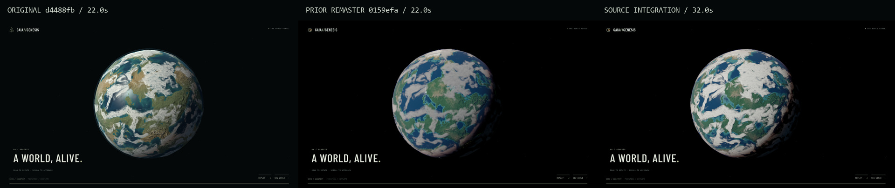

# Direct render captures — source integration

Windows Chrome / Intel UHD / 1920×1080 / native DPR 1 / seed 162711.
These are browser captures, not painted scenes. JPEGs encode original PNGs;
comparison sheets only resize/place captures and add captions.

| Stage | Current 32-second film | Prior 22-second film, where comparable |
| --- | --- | --- |
| Planetesimals | [1.5 s](1.5.jpg) | [Accretion, 1.8 s](../remaster/after/1.8.png) |
| Before contact | [6.2 s](6.2.jpg) | No corresponding physical collision stage |
| Contact / peak aftermath | [7.3 s](7.3.jpg) / [9.5 s](9.5.jpg) | No corresponding physical collision stage |
| Reassembly | [10.7 s](10.7.jpg) | No corresponding particle assembly stage |
| Liquid differentiation | [13.9 s](13.9.jpg) | [5.1 s](../remaster/after/5.1.png) |
| Cooling | [17.5 s](17.5.jpg) | [9.0 s](../remaster/after/9.0.png) |
| Mature anatomy | [26.1 s](26.1.jpg) | [16.9 s](../remaster/after/16.9.png) |
| Final | [32.0 s](32.0.jpg) | [22.0 s](../remaster/after/22.0.png) |

Left: original `d4488fb`; middle: prior remaster `0159efa`; right: this source
integration. The original has stronger fine weather than the prior remaster.
The revision deliberately restores those filaments rather than claiming a
blurrier volume is an improvement. Terrain/materials and film-time cloud drift
differ, so this is an art-direction comparison, not a pixel-aligned benchmark.

The opening now shows actual mergers; the impact visibly deforms, heats and ejects
material; the reassembly is a large source-shaded point cloud. Anatomy geometry
is preserved. Limits remain: bounded collision resolution reveals some particle
scalloping, clouds are hybrid, and exterior fidelity is not NASA photography.
