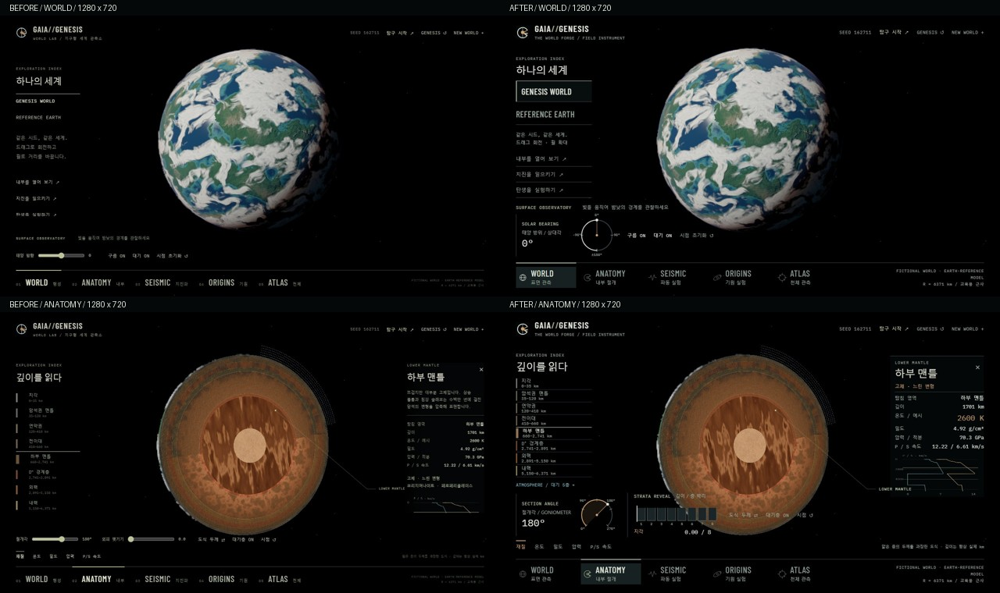

# World Forge instrument UI — actual Chrome captures

Before: `26b6977`. After: this release. Windows Chrome, hardware-accelerated Intel UHD / ANGLE D3D11, DPR 1, seed 162711. Images are actual browser frames converted to JPEG; no scene retouching. The montage only resizes and labels captures. Active cloud/experiment clocks differ; these are UI comparisons, not whole-frame rendering equivalence claims.

| Mode | Before 1080p | After 1080p | Before 720p | After 720p |
|---|---|---|---|---|
| WORLD | [before](before-world-1920.jpg) | [after](after-world-1920.jpg) | [before](before-world-1280.jpg) | [after](after-world-1280.jpg) |
| ANATOMY | [before](before-anatomy-1920.jpg) | [after](after-anatomy-1920.jpg) | [before](before-anatomy-1280.jpg) | [after](after-anatomy-1280.jpg) |
| SEISMIC | [before](before-seismic-1920.jpg) | [after](after-seismic-1920.jpg) | [before](before-seismic-1280.jpg) | [after](after-seismic-1280.jpg) |
| ORIGINS | [before](before-origins-1920.jpg) | [after](after-origins-1920.jpg) | [before](before-origins-1280.jpg) | [after](after-origins-1280.jpg) |
| ATLAS | [before](before-atlas-1920.jpg) | [after](after-atlas-1920.jpg) | [before](before-atlas-1280.jpg) | [after](after-atlas-1280.jpg) |

[Boot before](before-boot.jpg) · [Observatory Wake after](after-boot.jpg) · [Atlas optics at 720p](after-optics-1280.jpg) · [Impact Chamber](after-impact-1280.jpg) · [Particle Genesis](after-stardust-1280.jpg)

Two visual review rounds preceded the final captures. Concrete corrections:

1. WORLD left navigation overflow: shorten redundant copy and fit all three entry links above the instrument rail.
2. ANATOMY: show all eight interior units, fold five atmospheric units into a separate accessible popover; retain the visible property readout and velocity graph.
3. Remove inherited button-span float/margin that displaced instrument icons and labels; enlarge the solar caption column.
4. ORIGINS: move actual experiment selection into a compact left console; eliminate duplicate tabs and overlapping credits.
5. ATLAS: fit all seven bodies and the source link at 720p; show one optical group at a time with the sun XY pad and custom calibration bars.

Only the intentional right-side inspector/optics content can scroll. The left index has no scrollbar, no clipped contents and no hidden overflow fix. All five modes also passed at 1600×900. Rendering sources and quality settings are unchanged; the fixed Earth exterior region was compared losslessly before JPEG conversion. See [verification](../../VERIFICATION.md).
