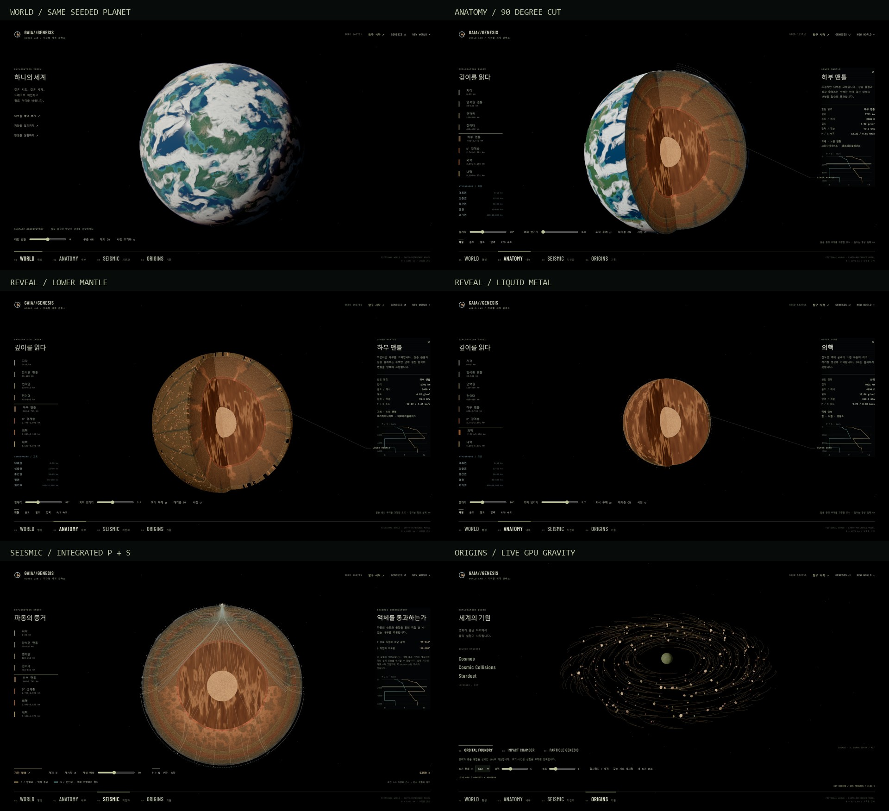
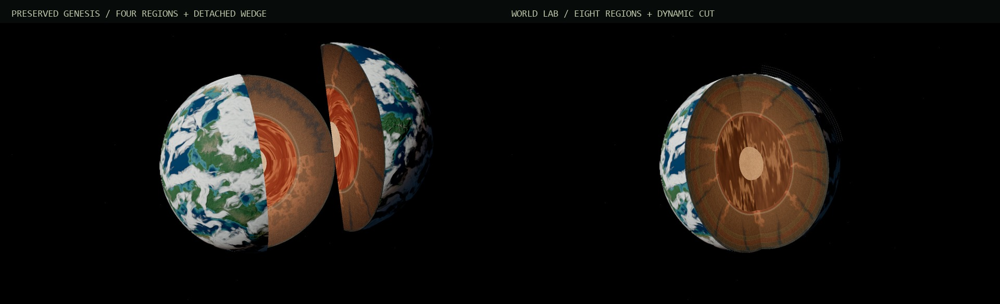

# World Lab — actual Windows Chrome renders

2026-11-12, Chrome 157 / Intel UHD ANGLE D3D11, native DPR 1. Seed **162711**.
1920×1080 unless explicitly 1280×720. JPEGs encode actual WebGL/browser PNG
captures; the contact/comparison sheets only place, resize and caption captures.
No generated or painted planet image is used.

| State | Capture |
| --- | --- |
| Mature procedural world | [WORLD](world.jpg) |
| Eight-unit anatomy, 90° | [ANATOMY](anatomy.jpg) |
| Rough hot-edge peel | [Lower mantle](lower-mantle.jpg) / [Outer core](outer-core.jpg) / [Inner core](inner-core.jpg) |
| Numerically integrated P/S fan, 1350 simulated seconds | [SEISMIC](seismic.jpg) |
| Genuine live gravity / mergers | [Cosmos](cosmos.jpg) |
| Configured independent collision, ratio .25 / speed 1.3 / angle 30° | [Approach](impact-approach.jpg) / [After contact](impact-contact.jpg) |
| 420,000 GAIA-seeded assembly targets | [Stardust](stardust.jpg) |
| Smaller desktop | [Anatomy 1280×720](anatomy-1280.jpg) / [Impact 1280×720](impact-1280.jpg) |

## Matched-camera comparison

Both are direct GPU captures at the **same seed, camera, world rotation and
26.1-second material/cloud time**. Left: the preserved Genesis four-region
geometry, detached 90° sector; its rendering source remains the baseline film.
Right: the independently implemented Lab eight-region geometry, continuous 90°
cut and connected caps. These are different representations, not an assertion
that the film's required detached-piece composition has been removed.

For the unchanged baseline's original full UI/exterior, see
[Genesis final 32 s](../source-integration/32.0.jpg) and
[Genesis anatomy 26.1 s](../source-integration/26.1.jpg). The Lab WORLD capture
keeps the same final camera and seed; living clouds naturally advance after film
completion. Atmosphere region arcs are explicitly schematic; interiors are
scientific illustrations, not photographs or measured generated-world profiles.
